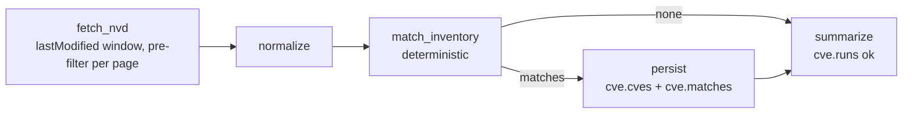

# CVE triage agent: checkpoint A runbook (Q-2.1-04)

Goal: the deterministic half of the agent runs on the VPS. It fetches CVEs modified
since the last run from NVD, normalises them, matches them against the synthetic
inventory by CPE and version range, and stores runs, CVEs and matches in Postgres.
**No LLM yet** (that is checkpoint B).



Time: about 30–45 min on the VPS. Everything runs in `/opt/agent-ops`.

## What the code does

| File | Role |
|---|---|
| `nvd.py` | NVD API 2.0: page iterator, `lastModStartDate/EndDate` window (split at 120 days), CPE dictionary lookup |
| `normalize.py` | CVE id, status, CVSS (NVD's Primary score first, newest version first; CNA score only as fallback), CWE, CISA KEV fields, CPE configurations |
| `matcher.py` | CPE 2.3 parsing, version comparison, three-valued AND/OR evaluation of NVD configurations, result per host software: `affected` / `not_affected` / `needs_review` |
| `db.py` | `PostgresStore` (runs, CVE upsert, matches) and an in-memory store for tests |
| `triage.py` | The LangGraph graph and the run bookkeeping |
| `verify_cpes.py` | Checks every inventory CPE against the NVD CPE dictionary |

Design decisions worth knowing:

- **Window.** First run: `TRIAGE_BACKFILL_DAYS` (default 7) of *modified* CVEs (new ones count as modified). Later runs start at the end of the last *successful* run minus 15 minutes, so a record NVD indexes late is not lost. A failed run does not move the window.
- **Memory.** NVD can return thousands of modified records per day. `fetch_nvd` keeps only records whose CPE criteria name an inventory vendor:product (or, if NVD has not analysed them yet, whose description names an inventory product). Only CVEs with at least one match row are written to `cve.cves`.
- **`needs_review` instead of guessing** when: a version sits on a range bound with a different suffix (`9.3:p2` vs `< 9.3`); the criterion has no version (`-`, older Microsoft records); a running-on condition names a product the host does not list; NVD has not analysed the CVE yet but its description names an inventory product. A CVE whose analysis is pending shows up again in a later window once NVD adds the configuration (its lastModified changes).
- **Unanalysed CVEs need the vendor's own CNA.** Run 1 (2026-11-22, 7 days, 7,700 CVEs) produced 630 `needs_review`, all from the description fallback; 40 of them were third-party products that only mention an inventory product (hMailServer "with a PostgreSQL database", golang-fips/openssl). Since then each software entry can list `cna_sources` (NVD `sourceIdentifier` of the vendor PSIRT / project CNA, taken from run 1); an unanalysed CVE counts only if it names the product **and** comes from one of them. The remaining volume is real: ~528 kernel.org CVEs per week waiting in NVD's backlog.
- **Replay.** `TRIAGE_WINDOW_START` / `TRIAGE_WINDOW_END` re-run a fixed window, e.g. to compare matcher versions on the same data.
- **Evidence.** Each match row stores the criteria that decided it and why (`match_detail.evidence`).

## 1. Pull, build, test

```bash
cd /opt/agent-ops
git pull
docker compose build cve-triage
```

Optional: `TRIAGE_BACKFILL_DAYS=7` in `.env` (the default is 7 anyway).

## 2. Verify the inventory CPEs against the NVD dictionary

```bash
docker compose run --rm cve-triage python -m cve_triage.verify_cpes
```

Each CPE prints `OK`, `DEPRECATED` (with replacement) or `MISSING` (with the dictionary names that exist for that version). Exit code 0 means all OK. Paste the output to Claude; the YAML gets corrected from it. Because the inventory is mounted read-only into the container, a corrected YAML needs `git pull` but no rebuild.

Expect at least one finding: NVD's dictionary often has no entry for a specific Windows build (`windows_server_2019:10.0.17763.5329`). That is fine for matching, since Microsoft CVEs use version ranges on build numbers, but it should be a conscious decision in the YAML.

## 3. First triage run

```bash
docker compose run --rm cve-triage
```

Expected output (numbers will differ):

```json
{
  "run_id": 1,
  "window_start": "2026-11-16T09:00:00+00:00",
  "window_end": "2026-11-23T09:00:00+00:00",
  "fetched": 4210,
  "candidates": 96,
  "match_rows": 140,
  "by_result": {"affected": 88, "needs_review": 31, "not_affected": 21},
  "by_host": {"web-ob-01": {"affected": 70, "needs_review": 25}, "...": {}},
  "actionable_sample": ["CVE-2026-... -> web-ob-01 (affected)", "..."],
  "stored_cves": 96,
  "langsmith_run_id": "..."
}
```

Expect the Linux kernel on `web-ob-01` to dominate: kernel 5.15.0 is affected by most kernel CVEs. That is correct for the matcher; it matters for cost in checkpoint B (see open points).

Run time: with the NVD key, about 1 s per 2,000 records plus the pause between pages. Watch RAM in a second shell: `docker stats --no-stream`.

## 4. Check the database

```bash
docker compose exec postgres sh -c 'psql -P pager=off -U "$POSTGRES_USER" -d "$POSTGRES_DB"' <<'SQL'
SELECT id, status, window_start, window_end, cves_fetched, matches_found, error FROM cve.runs ORDER BY id DESC LIMIT 3;
SELECT result, count(*) FROM cve.matches WHERE run_id = (SELECT max(id) FROM cve.runs) GROUP BY 1;
SELECT host_id, cve_id, result, match_detail->'evidence'->0->>'why' AS why
  FROM cve.matches WHERE run_id = (SELECT max(id) FROM cve.runs) AND result <> 'affected' LIMIT 15;
SQL
```

## 5. Hand-check the matcher (the precision metric)

Pick 5 rows by hand: at least 2 `affected`, 1 `not_affected`, 1 `needs_review`, ideally one from a non-kernel host. For each, open `https://nvd.nist.gov/vuln/detail/<CVE>` and check the configuration against the host's CPE in the YAML. Any disagreement is a bug; note the CVE id.

## 6. Second run (window continuity)

```bash
docker compose run --rm cve-triage
```

`window_start` must be 15 minutes before the first run's `window_end`; `fetched` should be small.

## Evidence for `done Q-2.1-04` checkpoint A

- Commit hash on the VPS (`git log --oneline -1`)
- `verify_cpes` output and the corrected YAML commit
- JSON summaries of runs 1 and 2
- Output of the step 4 queries
- The 5 hand-checked rows with verdicts
- LangSmith trace `cve-triage-a` (screenshot or link)
- `docker stats` peak for the `cve-triage` container during run 1

## Tests

```bash
cd agents/cve_triage
uv sync && uv run pytest -q          # offline: matcher, normaliser, graph with fake NVD pages
# Postgres layer, against a THROWAWAY database with the cve schema applied:
TEST_DATABASE_URL="host=... user=... dbname=..." uv run pytest -q tests/test_postgres_store.py
```

## Open points for checkpoint B

- **Which matches get assessed.** Every run stores its own match rows; a CVE that NVD modifies again appears again. Checkpoint B should assess a (CVE, host) only if there is no analysis yet or the CVE's lastModified/score/KEV status changed.
- **Kernel volume.** Dozens of kernel matches per week on one host. Options: assess per (host, product) batch, cap per run, or assess only CVSS ≥ 7 / KEV for the kernel. Decide before wiring the LLM.
- **Least privilege.** The agent connects as the Postgres owner. A dedicated role with INSERT/SELECT on `cve.*` only would be cleaner.
