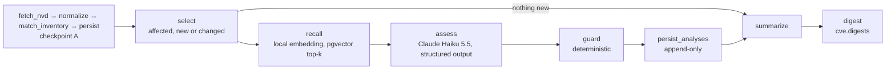

# CVE triage agent: checkpoint B runbook (Q-2.1-04)

Goal: the full agent runs on the VPS. On top of checkpoint A it recalls similar earlier
analyses from pgvector, lets Claude assess the priority of each affected (CVE, host), runs a
deterministic guard over the answer, stores every analysis append-only with its embedding,
and writes a markdown digest.



Time: about 45–60 min on the VPS. Everything runs in `/opt/agent-ops`.

## Design decisions (confirmed 2026-11-23)

| Question | Decision |
|---|---|
| Model | Switchable: `TRIAGE_LLM_PROVIDER=anthropic` → `claude-haiku-5-5` (default) or `openai` → `gpt-6-luna` (reasoning effort `low`). `TRIAGE_LLM_MODEL` overrides. Same prompt, schema and guard; `<provider>:<model>` and prompt version stored on every row |
| What reaches the model | Only matcher result `affected`. `needs_review` (NVD analysis pending) is one counted line in the digest |
| Re-assessment | Only when the fingerprint (result, CVSS, KEV) of a (CVE, host) changed since its last analysis |
| Kernel volume | CVSS < 7 and not KEV → rule floor only (`model = rule-only`, no call). Hard cap `TRIAGE_LLM_CAP` = 40 calls per run, most urgent first; the rest are stored rule-only, `needs_review = true`, and marked *deferred*, so a later window or a replay assesses them |
| Database identity | Dedicated role `cve_agent`: SELECT/INSERT, UPDATE only on run bookkeeping and the CVE cache, no DELETE/TRUNCATE/DDL. `cve.analyses` is append-only twice: no grant **and** the trigger |

| File | Role |
|---|---|
| `priority.py` | Rule floor (P1–P4) and the guard |
| `assess.py` | Selection and routing, prompt (`assess-v1`), structured output schema, Anthropic call |
| `memory.py` | Local embeddings (fastembed, `BAAI/bge-small-en-v1.5`, 384 dims), baked into the image |
| `digest.py` | Markdown template: P1/P2 in full, P3/P4 as counts per host + top 5, needs-review list |
| `db.py` | + fingerprints, recall, append-only analyses, digests, run cost |
| `db/migrations/002_cve_agent_role.sql` | Least-privilege role |

What the guard enforces (any failure keeps the rule priority):
- the answer is for exactly this CVE and host, parses against the schema, rationale non-empty → else `rejected`, `needs_review`
- no CVE id in the text except this one and the recalled ones → else `rejected`
- raising is free; lowering by one level only with a compensating control listed for that host, copied verbatim → else `corrected` back to the rule priority; lowering by two or more levels is clamped to one

Tested offline (73 tests) and against Postgres 16 + pgvector as owner and as `cve_agent`
(append-only, grants, fingerprints, recall, digest, rolled back).

## 1. Pull and configure

```bash
cd /opt/agent-ops
git pull
openssl rand -hex 24          # copy the output: password for the agent role
nano .env
```

Add (keep `chmod 600`):

```
ANTHROPIC_API_KEY=sk-ant-...
OPENAI_API_KEY=sk-...             # only needed for TRIAGE_LLM_PROVIDER=openai
TRIAGE_LLM_PROVIDER=anthropic     # or openai (GPT-6 Luna)
CVE_AGENT_USER=cve_agent
CVE_AGENT_PASSWORD=<hex from above>
# optional, from the price list of the model in use (USD per million tokens); empty = tokens only
TRIAGE_PRICE_IN_PER_MTOK=
TRIAGE_PRICE_OUT_PER_MTOK=
```

Check without printing secrets: `docker compose --profile jobs config | grep -E 'PGUSER|TRIAGE_LLM_MODEL|ANTHROPIC_API_KEY' | sed 's/sk-ant-.*/sk-ant-***/'`

## 2. Schema and role

```bash
# 2a. new table cve.digests (001 is idempotent; existing tables are untouched)
docker compose exec -T postgres sh -c 'psql -v ON_ERROR_STOP=1 -U "$POSTGRES_USER" -d "$POSTGRES_DB"' \
  < db/init/001_cve_memory.sql

# 2b. least-privilege role (idempotent; re-running rotates the password)
AU=$(grep '^CVE_AGENT_USER=' .env | cut -d= -f2-); AP=$(grep '^CVE_AGENT_PASSWORD=' .env | cut -d= -f2-)
docker compose exec -T postgres sh -c \
  'psql -v ON_ERROR_STOP=1 -U "$POSTGRES_USER" -d "$POSTGRES_DB" -v agent_user="$1" -v agent_pw="$2"' _ "$AU" "$AP" \
  < db/migrations/002_cve_agent_role.sql
unset AP
docker compose exec postgres sh -c 'psql -P pager=off -U "$POSTGRES_USER" -d "$POSTGRES_DB" -c "\dp cve.*"'
```

Expected: `cve_agent=ar` on `analyses` and `matches`, `arw` on `runs` and `cves`, `ar` + column `delivered_at: w` on `digests`.

## 3. Build

```bash
docker compose build cve-triage      # downloads the embedding model into the image (~130 MB)
docker images | grep cve-triage      # note the size
```

If the build fails at `python -m cve_triage.memory`: the VPS cannot reach Hugging Face; paste the error.

## 4. First run (continues the window from the last checkpoint-A run)

```bash
docker compose run --rm cve-triage
docker stats --no-stream   # in a second shell during the run
```

Output: the JSON summary, then the digest. New keys compared with A: `assessment`
(affected_pairs / unchanged / llm / rule-only / cap), `guard`, `final_priority`, `usage`, `needs_review`.
The window is short, so expect few model calls. That is fine.

## 5. Volume run (replay of run 1's 7-day window)

Shows the cap and kernel handling on real volume (run 1: 231 affected rows):

```bash
docker compose run --rm -e TRIAGE_WINDOW_START=2026-11-15T11:28:28 -e TRIAGE_WINDOW_END=2026-11-22T11:28:28 cve-triage
```

(Use the exact window of run 1 from `cve.runs` if it differs.) Expect `llm` ≤ 40, many `rule-only`
(kernel CVSS < 7), and a `cap` count if more than 40 pairs qualify. Run the same command again:
`unchanged` should cover everything assessed, and the deferred pairs go to the model.

### 5b. Optional: same window with GPT-6 Luna (model comparison)

The second model only sees pairs that are new or changed, so it needs a window the first model has not
assessed yet. Run it on the next daily window, or compare on a fresh throwaway database:

```bash
docker compose run --rm -e TRIAGE_LLM_PROVIDER=openai cve-triage
```

Keep one provider for the scheduled job (Q-2.1-05). The `model` column says which one assessed each row, so
the cycle 2.3 eval set can score both on the same cases.

## 6. Check the database

```bash
docker compose exec -T postgres sh -c 'psql -P pager=off -U "$POSTGRES_USER" -d "$POSTGRES_DB"' <<'SQL'
SELECT id, status, cves_fetched, matches_found, cost_usd, left(langsmith_trace, 8) FROM cve.runs ORDER BY id DESC LIMIT 3;
SELECT run_id, evidence->>'route' AS route, guard_result, final_priority, count(*), count(embedding) AS with_emb
  FROM cve.analyses GROUP BY 1,2,3,4 ORDER BY 1 DESC, 2, 3, 4;
SELECT host_id, cve_id, rule_priority, final_priority, guard_result, left(rationale, 140)
  FROM cve.analyses WHERE guard_result <> 'passed' OR final_priority <> rule_priority ORDER BY id DESC LIMIT 10;
SELECT run_id, length(markdown) FROM cve.digests ORDER BY id DESC LIMIT 3;
SQL
# append-only, tried as the agent role (must fail with "permission denied")
docker compose run --rm --entrypoint python cve-triage -c \
  "import psycopg; c=psycopg.connect(''); c.execute('DELETE FROM cve.analyses')"
```

## 7. LangSmith

Project `agent-ops-lab`, run `cve-triage` (tag `checkpoint-b`): the 11 graph nodes, under `assess` one
`ChatAnthropic` child per model call with tokens. Screenshot the trace of the volume run.

## 8. Hand check (priority agreement, recorded, no target yet)

Pick 5 model-assessed rows from step 6 (at least one `corrected` or model-changed one, if any). For each:
your own priority (P1–P4) and one line why. Agreement count = the first data point for the eval set in cycle 2.3.

## Evidence for `done Q-2.1-04`

- Commit hash on the VPS (`git log --oneline -1`)
- `\dp cve.*` output (step 2)
- JSON summaries of the runs from steps 4 and 5 (+ the repeat), and one digest
- Output of the step 6 queries, including the refused DELETE
- LangSmith trace screenshot (volume run)
- `docker stats` peak and image size
- The 5 hand-checked rows with your verdicts

## Open points for later cycles

- **Deferred backlog** is only reassessed when a pair reappears (new NVD version or replay). A
  scheduled "assess deferred" pass is a candidate for Q-2.1-05 or cycle 2.3.
- **Digest per run** covers that run's new analyses; the weekly digest for Q-2.1-05 aggregates across runs.
- **Eval set** (cycle 2.3): the step 8 rows plus guard edge cases become LangSmith dataset examples.
