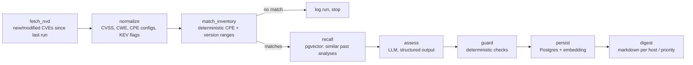

# CVE triage agent: product brief

> Automation #1 in `agent-ops-lab` (cycle 2.1, Nov 23 – Dec 6, 2026). Scope decided 2026-11-21.
> Public data (NVD) and a **synthetic** bank IT estate only.

## Why this matters for a bank

Every regulated bank must find, prioritise and fix vulnerabilities in its ICT estate and prove it did so. Under DORA this is explicit: the ICT risk-management RTS (Commission Delegated Regulation (EU) 2024/1774) requires a documented vulnerability and patch-management process. In practice, analysts read dozens of new CVEs a day, check by hand whether anything in the inventory is affected, and write the reasoning into a ticket nobody can find six months later.

This agent does the first pass: it pulls new CVEs, works out **deterministically** which machines are affected, lets an LLM assess the business priority in context, and stores every assessment with its evidence so the next decision, and the auditor, can find it.

## User and problem

| | |
|---|---|
| **Primary user** | Vulnerability-management analyst in a mid-size bank's IT security team |
| **Secondary user** | CISO / ISO, who reads the weekly summary |
| **Problem** | Too many new CVEs, too little time to match them to the estate; priorities are inconsistent between analysts and the reasoning is not kept |
| **Job to be done** | "Tell me which new CVEs hit which of my machines, how urgent each one is and why, and remember what we decided last time" |

## How it works (v0)

| Node | Deterministic? | What it does |
|---|---|---|
| `fetch_nvd` | yes | NVD CVE API 2.0, `lastModStartDate`/`lastModEndDate` window since the last successful run; respects the rate limit (API key recommended) |
| `normalize` | yes | Extracts CVE id, CVSS (v3.1, v4.0 if present), CWE, CPE match criteria with version ranges, CISA KEV fields that NVD carries |
| `match_inventory` | **yes** | Compares CPE vendor:product and version ranges against `agents/cve_triage/inventory/bank-estate.yaml`. Result per host: `affected`, `not_affected` or `needs_review` (unparseable version). **The LLM never decides whether a machine is affected** |
| `recall` | yes (retrieval) | Top-k similar earlier analyses from pgvector (same product, CWE, description) so priorities stay consistent |
| `assess` | LLM | Per affected host: priority P1–P4, rationale, recommended action, fields cited. Context: host zone, criticality, data class, compensating controls, recalled analyses |
| `guard` | **yes** | Rejects or corrects the LLM output (rules below) |
| `persist` | yes | Writes CVE, matches, analysis and embedding; append-only |
| `digest` | yes (template) | Markdown digest grouped by priority and host |

### Priority rules (the guard enforces them)

A rule-based **floor** comes first; the LLM refines it.

| Rule priority | Condition |
|---|---|
| P1 | CVSS ≥ 9.0 on an internet-facing or `critical` host, or CVE is in CISA KEV on any affected host |
| P2 | CVSS ≥ 7.0 on an internet-facing or `critical` host, or CVSS ≥ 9.0 anywhere else |
| P3 | CVSS ≥ 4.0 |
| P4 | everything else |

The guard checks that:
- every CVE id and host id in the LLM output exists in the matches for this run (no invented findings)
- the LLM may **raise** a priority freely, with a reason
- the LLM may **lower** it by at most one level, and only by citing a compensating control listed for that host in the inventory
- the rationale is non-empty and the output parses against the schema; otherwise the rule priority stands and the case is flagged `needs_review`

## Context memory

Postgres 17 with **pgvector**, in the existing `agent-ops` stack (schema `cve`, see `db/init/001_cve_memory.sql`).
- `cve.cves`: normalised CVE records (raw NVD JSON kept)
- `cve.matches`: CVE × host results of the deterministic matcher
- `cve.analyses`: every assessment with rule priority, final priority, rationale, evidence, model, prompt version, guard result, LangSmith run id and an embedding. **Append-only** (update/delete blocked by trigger); a re-assessment is a new row
- Embeddings: local `fastembed` model (`BAAI/bge-small-en-v1.5`, 384 dimensions) on the VPS, so no CVE text or inventory leaves the box for embedding

## Success metrics

| Metric | v0 target (Dec 6) | Later |
|---|---|---|
| Digest delivered automatically | 1 per week, unattended | daily |
| Traced in LangSmith | every run | + eval set ≥ 15 cases (cycle 2.3) |
| Matcher precision on a hand-checked sample | 100 % (deterministic, any miss is a bug) | — |
| Priority agreement with my own judgement | recorded, no target | ≥ 85 % on the eval set |
| Cost per run and per assessed CVE | measured | reported in the digest |

## Out of scope for v0

- No scanning of real machines, no agents on hosts; the inventory is a synthetic YAML file
- No ticket creation, no messages to system owners: that needs the human approval gate (cycle 2.4)
- Sources other than NVD (CISA KEV feed, EPSS, BSI/CERT-Bund, vendor CSAF) are candidates for later cycles
- No Google Drive export (possible later as a weekly report copy)

## Open questions

- Exact CPE strings in the inventory must be checked against the NVD CPE dictionary in checkpoint A of `Q-2.1-04`
- How to handle CVEs whose NVD analysis is still pending (no CPE configuration yet): likely `needs_review` with a re-check on the next run
